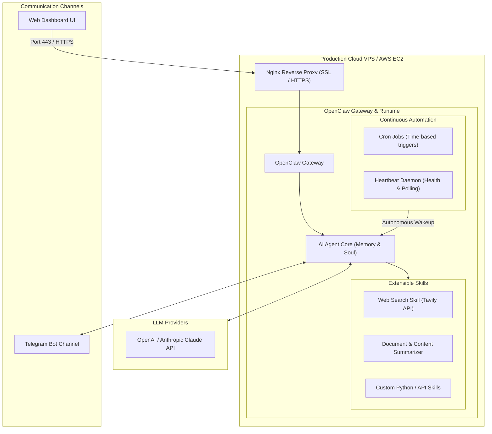

# 🚀 OpenClaw Crash Course: Build 24/7 Cloud AI Agents

<div align="center">

[](https://github.com/codewithmuh/openclaw-crash-course/releases)
[](https://opensource.org/licenses/MIT)
[](https://github.com/codewithmuh/openclaw-crash-course/stargazers)
[](https://github.com/codewithmuh/openclaw-crash-course/network/members)
[](https://www.docker.com/)
[](https://nginx.org/)
[](https://telegram.org/)
[](https://www.youtube.com/@codewithmuh)

**Complete hands-on masterclass for deploying OpenClaw on cloud VPS / AWS EC2 and orchestrating autonomous, 24/7 AI agents connected to Telegram, webhooks, and cron triggers.**

[Overview](#overview) • [System Architecture](#system-architecture) • [Course Roadmap](#-table-of-contents) • [Server Setup Guide](#quick-start-server-setup) • [Outcome](#-outcomes--capabilities)

</div>

---


## Overview

In this comprehensive crash course, you will learn how to deploy **OpenClaw** (alongside Clawdbot and Moltbot architectures) onto production cloud infrastructure (Hostinger VPS or AWS EC2) and build an autonomous AI-powered assistant that operates 24/7 without manual intervention.

From Docker containerization, Nginx reverse proxy configuration, and Let's Encrypt SSL certificates to agent memory retention, custom tool skills, and automated cron triggers, this guide provides the end-to-end blueprint for autonomous agent operations.

---

## System Architecture



---

## 🧭 What We Will Build

A production **Daily Telegram AI Assistant** that:
- 🔍 Automatically polls data sources and conducts targeted web searches using Tavily.
- 🧠 Synthesizes unstructured information and extracts key insights using LLMs.
- ⏰ Operates autonomously on scheduled cron intervals and background heartbeats.
- 📱 Delivers structured daily executive summaries directly to your Telegram chat.

---

## Quick Start: Server Setup

### 1. Initial VPS Provisioning & Docker Install

```bash
# Update and install dependencies
sudo apt update && sudo apt upgrade -y
sudo apt install -y curl git ufw

# Install Docker & Docker Compose
curl -fsSL https://get.docker.com -o get-docker.sh
sudo sh get-docker.sh
sudo usermod -aG docker $USER
```

### 2. Configure Firewall (UFW)

```bash
sudo ufw allow 22/tcp    # SSH
sudo ufw allow 80/tcp    # HTTP
sudo ufw allow 443/tcp   # HTTPS
sudo ufw enable
```

### 3. Deploy OpenClaw

```bash
# Clone and prepare environment
git clone https://github.com/codewithmuh/openclaw-crash-course.git
cd openclaw-crash-course

# Configure LLM keys and credentials
cp .env.example .env
nano .env

# Run OpenClaw daemon
docker compose up -d
```

---

## 📚 Table of Contents & Timestamps

### 🖥️ 1. Server Setup (Real Environment First)
- `00:00:00` **Introduction** — Why OpenClaw and autonomous agents matter
- `00:03:00` **Project Vision** — Daily AI Assistant running 24/7
- `00:05:30` **Course Roadmap** — Architecture and milestones
- `00:07:00` **Local vs VPS** — Why cloud servers are essential for non-stop agents
- `00:09:30` **Creating VPS** — Hostinger VPS and AWS EC2 provisioning
- `00:14:00` **SSH Terminal Access** — Secure remote management
- `00:17:00` **Docker Setup** — Installing Docker CE & Compose engine
- `00:21:00` **OpenClaw Installation** — Container deployment
- `00:25:00` **API Credentials** — Configuring Anthropic Claude & OpenAI keys
- `00:28:00` **Terminal Verification** — Validating first execution

### 🌐 2. Hosting & Web Access
- `00:31:00` **Container Management** — Docker lifecycle and restart policies
- `00:34:00` **Port Mapping** — Configuring UFW firewall rules
- `00:36:00` **Direct Web UI Access** — Accessing dashboard via server IP
- `00:39:00` **Domain Name Configuration** — DNS A-record mapping
- `00:42:00` **Nginx Reverse Proxy** — Upstream proxying to container ports
- `00:46:00` **SSL Encryption** — Certbot Let's Encrypt automated TLS certificates
- `00:49:00` **Production Web UI** — Secure domain access

### 🧠 3. Core Architecture
- `00:52:00` **OpenClaw Gateway** — Message routing and request handling
- `00:54:00` **Agent Definitions** — Persona, purpose, and capability mapping
- `00:57:00` **Memory & Soul** — Persistent identity and conversational context
- `01:00:00` **Skill Extensibility** — Tool and function-calling mechanics
- `01:03:00` **Architecture Deep Dive** — Event loops and agent execution flow

### 🔌 4. Channel Integration
- `01:06:00` **Creating First Agent** — Role-based prompt engineering
- `01:09:00` **Connecting Telegram** — Telegram BotFather setup and webhook binding
- `01:13:00` **Connecting WhatsApp** — Optional multichannel deployment

### 🛠️ 5. Skills Creation & Tool Use
- `01:16:00` **Managing Skills** — Enabling and auditing tool permissions
- `01:19:00` **Custom Summarizer Skill** — Structured extraction logic
- `01:24:00` **Web Search Skill** — Integrating Tavily API for real-time browsing

### ⚙️ 6. Autonomous Scheduling
- `01:29:00` **Cron Triggers** — Time-based schedule definitions
- `01:32:00` **Heartbeats** — Background state polling and keep-alive checks
- `01:36:00` **Logic Patterns** — Error recovery and retry policies

### 🧩 7. Multi-Agent Systems
- `01:40:00` **Work Agent vs Personal Agent** — Separation of concerns
- `01:43:00` **Orchestration Architecture** — Inter-agent messaging and handoffs

### 🚀 8. Capstone Project
- `01:47:00` **Building Daily Telegram Assistant** — Full integration
- `01:54:00` **Live Testing & Verification** — Validating automated notifications

### 🔐 9. Security & Hardening
- `01:58:00` **Credential Safety** — Restricting API key blast radius
- `02:01:00` **VPS Hardening** — SSH key-only auth, fail2ban, and Docker isolation
- `02:04:00` **When NOT to use OpenClaw** — Limitations and trade-offs
- `02:06:00` **Course Wrap-Up** — Next steps and community support

---

## 🎯 Outcomes & Capabilities

By completing this crash course, you will be equipped to:
1. **Deploy and harden** autonomous agent environments on any Linux VPS or AWS EC2 instance.
2. **Expose secure dashboards** behind Nginx reverse proxies with automated HTTPS.
3. **Equip AI agents** with custom tools, live web search capabilities, and long-term memory.
4. **Automate repetitive tasks** 24/7 without requiring active terminal sessions or desktop machines.

---

## Resources & Community

- **Full Video Tutorial:** [Watch on YouTube @codewithmuh](https://www.youtube.com/@codewithmuh)
- **Official OpenClaw Docs:** Explore agent runtime documentation and community modules.
- **Support & Issues:** Submit bugs or questions via [GitHub Issues](https://github.com/codewithmuh/openclaw-crash-course/issues).

---

## License

This project is licensed under the [MIT License](LICENSE).
